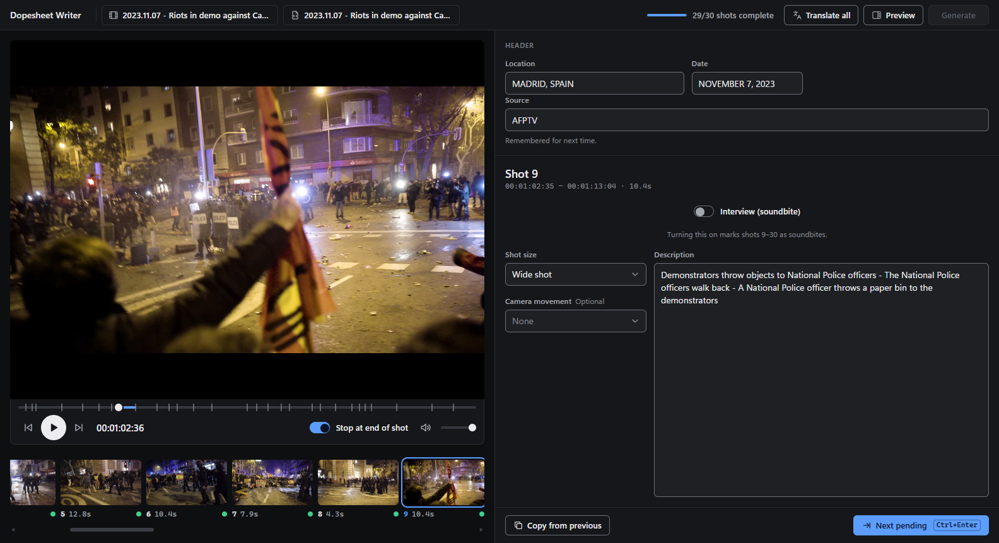
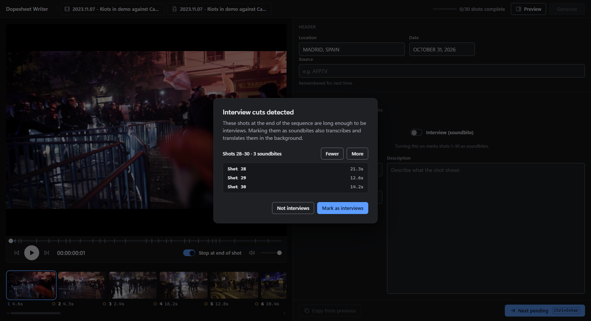
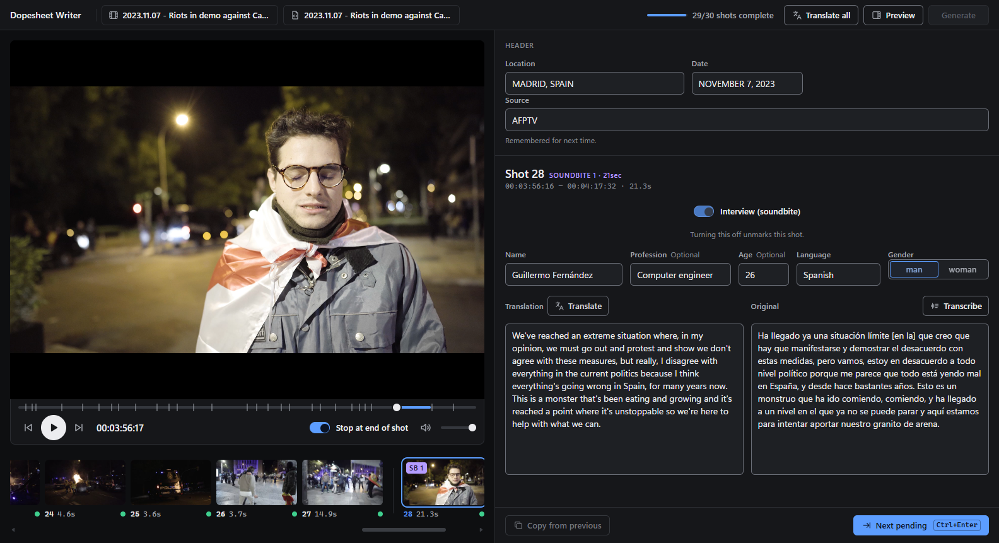
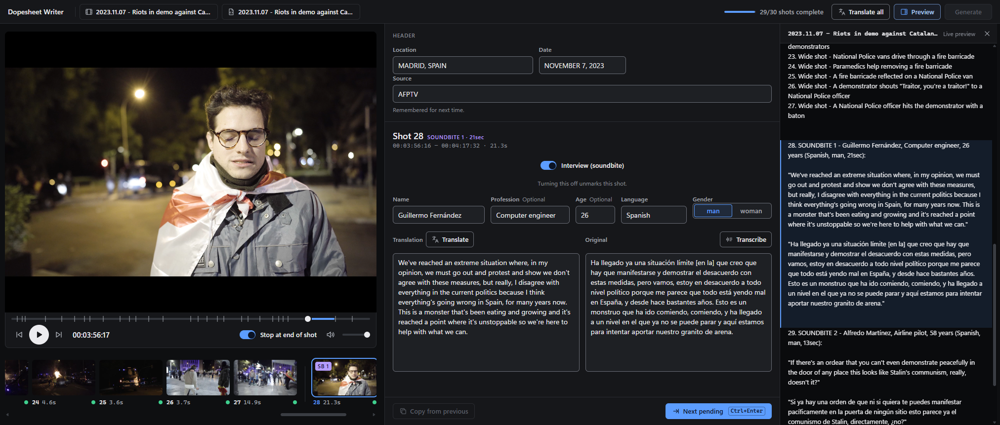
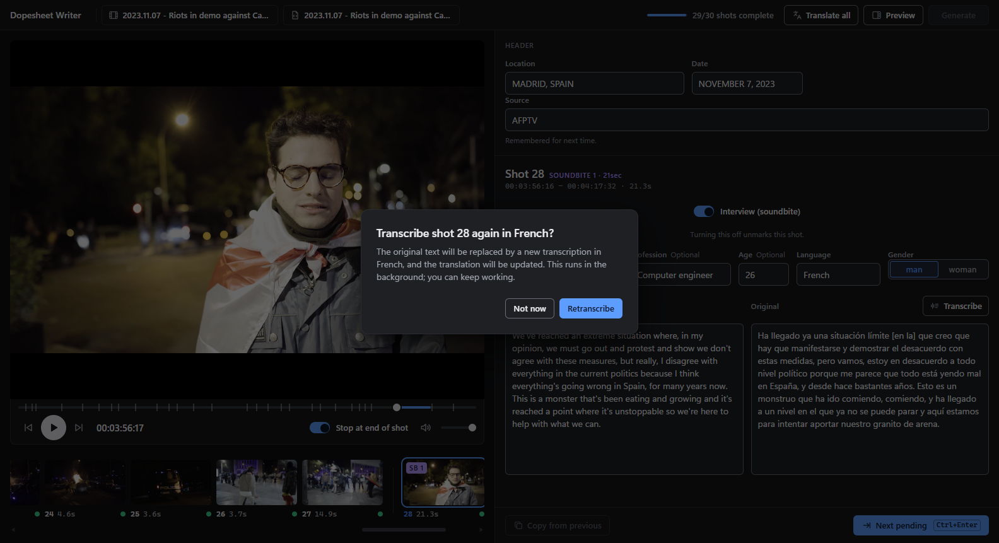

# Dopesheet Writer

[](CHANGELOG.md)
[](LICENSE)


Desktop app that writes the agency shotlist (dopesheet) of an edited video report from the video and its Premiere / Final Cut XML.



## Features

- **Cuts from the XML.** Reads xmeml v4 (Premiere, Final Cut 7), one shot per clip on V1, with its first frame as a thumbnail.
- **Guided annotation.** Shot size, camera movement and description per shot; progress bar and `Ctrl+Enter` to jump to the next pending shot.
- **Interviews.** Detects the long cuts at the end as soundbites and asks before marking them.
- **Local transcription.** Whisper large-v3 + Silero VAD on your machine (Windows). Detects the language; change it and the app offers to transcribe again.
- **Background queue.** Transcription and translation run while you keep working. Changes pile up in the same queue.
- **Translation.** English → Spanish, any other language → English, in one click.
- **Live preview.** The final text, updated as you type (`Alt+P`).
- **Drafts.** Autosaved per video; reopen and carry on.
- **Agency format.** Writes `<video name>.txt` next to the video: UTF-8, header, IMAGES and SOUNDBITE blocks.

| Interview detection | Soundbite |
|---|---|
|  |  |
| **Live preview** | **Change the language, transcribe again** |
|  |  |

## Requirements

- Windows 11 (main target) or macOS (untested). Transcription is Windows only.
- Node.js 24 to run from source.
- An H.264 MP4 export of the edit. ProRes, DNxHD and other codecs Chromium can't decode are not supported.

## Install and run

```bash
git clone https://github.com/jaimealekos/dopesheetwriter.git
cd dopesheetwriter
npm install
npm start
```

Package for Windows (`dist/DopesheetWriter-win32-x64`):

```bash
npm run package:win
```

### Transcription (optional)

Place these files in `vendor/transcriber/` before packaging:

| File | Source |
|---|---|
| `ffmpeg.exe` | [FFmpeg](https://ffmpeg.org/download.html) |
| `whisper/whisper-cli.exe` (+ DLLs) | [whisper.cpp](https://github.com/ggml-org/whisper.cpp/releases) |
| `models/ggml-large-v3-q8_0.bin` | [whisper.cpp models](https://huggingface.co/ggerganov/whisper.cpp) |
| `models/ggml-silero-v6.2.0.bin` | [Silero VAD for whisper.cpp](https://huggingface.co/ggml-org/whisper-vad) |

Without them the app works; the Transcribe button stays disabled.

## Usage

1. Drop the video (its XML with the same name loads by itself) or pick both.
2. Fill in the header and annotate each shot.
3. Confirm the detected interviews; transcription and translation start in the background.
4. Review, then **Generate**.

## Privacy

Video and audio never leave your computer. **Translate** sends the soundbite text to `translate.googleapis.com` (fallback: `api.mymemory.translated.net`). Nothing else goes online.

## Development

```bash
npm test
```

Plain JavaScript, no build step. Design and module contracts in [`docs/`](docs/ARQUITECTURA.md) (Spanish).

## Contributing

See [CONTRIBUTING.md](CONTRIBUTING.md) and the [Code of Conduct](CODE_OF_CONDUCT.md). Security issues: [SECURITY.md](SECURITY.md).

## License

[MIT](LICENSE) © 2026 Jaime Alekos. FFmpeg, whisper.cpp and the models keep their own licenses.
